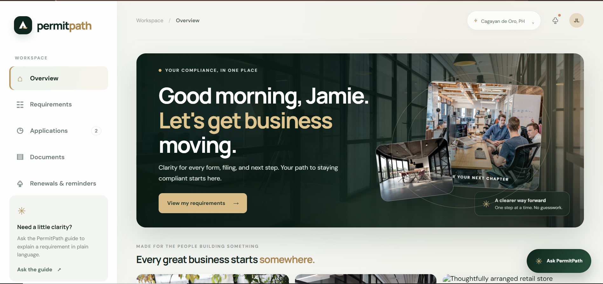
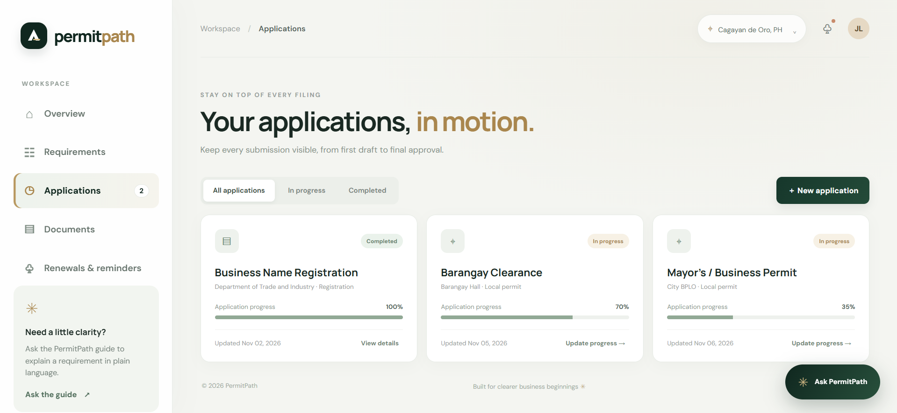
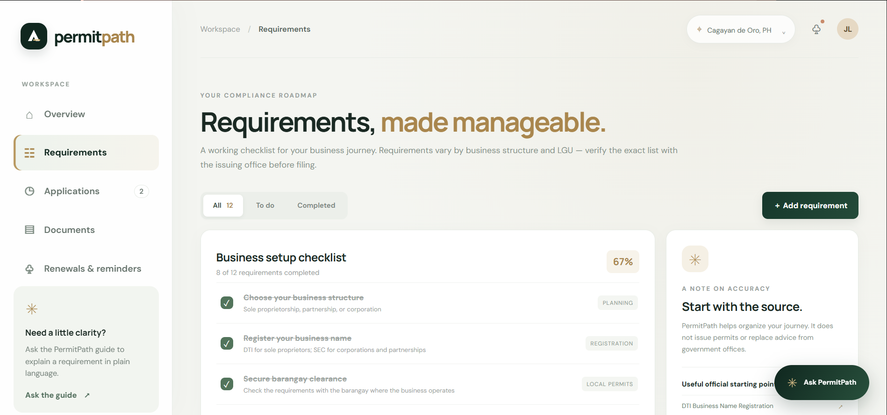
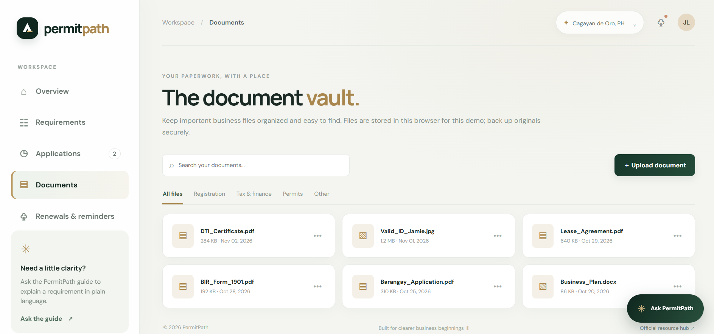

 <!-- README.md -->

<div align="center">

<!-- UNIQUE ANIMATED HEADER -->


<br/>

**A smarter, simpler way to navigate business registration and permit requirements.**

<br/>

[](https://developer.mozilla.org/en-US/docs/Web/HTML)
[](https://developer.mozilla.org/en-US/docs/Web/CSS)
[](https://developer.mozilla.org/en-US/docs/Web/JavaScript)
[](https://github.com/rheillunio2-byte/Permit-Path?tab=MIT-1-ov-file)
[](#)

<br/>

[Overview](#-overview) •
[Features](#-features) •
[Preview](#-application-preview) •
[Installation](#-installation) •
[Contributing](#-contributing) •
[License](#-license)

</div>

---

## 🌿 Overview

**PermitPath** is a business permit and registration assistance platform concept designed to help entrepreneurs and business owners better understand, organize, and track their business compliance journey.

Starting and maintaining a business involves different requirements, documents, applications, and renewal deadlines. These processes can become confusing, especially for first-time business owners.

PermitPath aims to make that experience more manageable through a clean, organized, and user-friendly interface.

Instead of navigating scattered information, users can explore business requirements, organize important documents, monitor application progress, and keep track of upcoming renewals in one place.

Built around a modern and professional design, PermitPath combines practical dashboard features with a simple workflow that helps users move forward with greater clarity.

### ✨ Our Goal

To make business registration and permit compliance easier to understand, easier to organize, and less overwhelming for entrepreneurs.

> **PLAN. PREPARE. REGISTER. GROW.**

---

## 📸 Application Preview

<div align="center">

### Dashboard Overview



*An organized dashboard for monitoring business registration and compliance progress.*

<br/>

### Application



*Keep track of business application information and progress.*

<br/>

### Permit Requirements



*Explore and organize the requirements associated with business permits.*

<br/>

### Document Management



*Keep important business documents organized and accessible.*

<br/>

### Renewals and Reminders


*Monitor renewal schedules and important compliance deadlines.*

<br/>

### Ask Permit


*Get helpful guidance through the Ask Permit interface.*

</div>

---

## 🚀 Features

PermitPath brings together essential tools and interface elements to support a more organized business compliance experience.

### 📊 1. Dashboard Overview

- View important business information in one place.
- Monitor application and compliance progress.
- Access essential platform sections quickly.
- Keep track of important business activities.

### 📝 2. Business Application

- Organize business application information.
- Follow the application workflow.
- Review relevant business details.
- Keep application-related information accessible.

### 📋 3. Permit Requirements

- Browse business permit requirements.
- Review the documents associated with different processes.
- Organize requirements before proceeding with applications.
- Make preparation more structured and understandable.

### 📁 4. Document Management

- Organize important business documents.
- Keep track of document-related information.
- Make document management more convenient.
- Maintain a more structured compliance workspace.

### 🔔 5. Renewals and Reminders

- Monitor upcoming permit renewals.
- Keep important deadlines visible.
- Organize renewal-related information.
- Help reduce the chances of overlooking important dates.

### 💬 6. Ask Permit

- Explore a dedicated assistance interface.
- Get predefined guidance and explanations.
- Make common business compliance topics easier to understand.
- Provide a convenient starting point when users need help navigating the platform.

**Note:** Ask Permit currently uses predefined/demo guidance. It is not a live AI-powered service.

### 🎨 7. Premium User Interface

- Modern forest-green, warm ivory, and champagne-gold color palette.
- Clean and professional dashboard layout.
- Animated visual elements and refined transitions.
- Image-based sections and elegant presentation.
- Interactive hover effects.
- Responsive layout for different screen sizes.
- Reduced-motion support for users who prefer fewer animations.

---

## 🛠️ Built With

PermitPath uses standard front-end web technologies.

| Technology | Purpose |
|---|---|
| HTML5 | Application structure and content |
| CSS3 | Styling, animations, layout, and responsiveness |
| JavaScript | Interactive components and application behavior |
| Local Storage | Saving supported prototype data in the browser |
| Unsplash Images | Remote photography used in selected visual sections |

### Technology Highlights

- No backend server is required for the current prototype.
- No API keys are required for the current implementation.
- No npm installation is required.
- The application can be opened using a local development server or browser.

---

## 📦 Installation

Follow these steps to run PermitPath locally.

### 1. Clone the Repository

```bash
git clone https://github.com/rheillunio2-byte/Permit-Path.git
```

### 2. Navigate to the Project Folder

```bash
cd Permit-Path
```

### 3. Open the Project

You can open the project folder using Visual Studio Code.

### 4. Run the Application

Recommended: use the **Live Server** extension in Visual Studio Code.

1. Open `index.html`.
2. Right-click inside the editor.
3. Select **Open with Live Server**.
4. PermitPath will open in your browser.

Alternatively, open `index.html` directly in a modern web browser.

---

## 📂 Project Structure

The project follows a simple and organized front-end structure.

```text
Permit-Path/
│
├── index.html
├── styles.css
├── app.js
│
├── assets/
│   └── (Project assets)
│
├── images/
│   ├── Application.PNG
│   ├── Ask Permit.PNG
│   ├── Documents.PNG
│   ├── Overview.PNG
│   ├── Renewals and Reminders.PNG
│   └── Requirements.PNG
│
├── README.md
├── CONTRIBUTING.md
├── LICENSE
└── .gitignore
```

---

## 💡 Why PermitPath?

Business registration and permit compliance can involve multiple steps, documents, and deadlines.

For new entrepreneurs, understanding where to begin can be challenging. For existing business owners, keeping everything organized can become another responsibility.

PermitPath was designed around a simple idea:

**Business owners should have a clearer way to organize their next steps.**

By bringing essential information and organizational tools into one interface, PermitPath aims to make the business compliance experience more approachable.

It focuses on:

- **Clarity** — Present information in an organized and understandable way.
- **Accessibility** — Make important sections easy to find.
- **Organization** — Keep applications, documents, and renewals together.
- **Convenience** — Provide a central place to manage supported prototype information.
- **Simplicity** — Reduce unnecessary complexity through a straightforward interface.

---

## 🗺️ Future Improvements

PermitPath is a prototype with room for further development.

Potential improvements include:

- [ ] Real-time business permit requirement information.
- [ ] Integration with relevant government services and agencies.
- [ ] User accounts and secure authentication.
- [ ] Cloud-based document storage.
- [ ] Actual application submission and status tracking.
- [ ] Automated renewal notifications.
- [ ] Live AI-powered business permit assistance.
- [ ] More comprehensive business registration guides.
- [ ] Location-specific requirements for different Philippine cities and municipalities.
- [ ] Improved accessibility and multilingual support.

These improvements are planned possibilities and are not necessarily available in the current version.

---

## 🤝 Contributing

Contributions, suggestions, and improvements are welcome!

If you would like to contribute to PermitPath, please read the [CONTRIBUTING.md](CONTRIBUTING.md) file before submitting changes.

You can contribute by:

- Reporting bugs.
- Suggesting new features.
- Improving the user interface.
- Enhancing accessibility.
- Improving documentation.
- Submitting code improvements.

### Basic Contribution Workflow

1. Fork the repository.
2. Create a new branch.
3. Make your changes.
4. Test your changes locally.
5. Commit your updates.
6. Submit a pull request.

---

## 📄 License

PermitPath is distributed under the **MIT License**.

See the [LICENSE](https://github.com/rheillunio2-byte/Permit-Path?tab=MIT-1-ov-file) file for more information.

---

## 👨‍💻 Developer

<div align="center">


### Rheil Evans T. Lunio

**Developer & Creator of PermitPath**

[](https://github.com/rheillunio2-byte)

[Visit the Repository](https://github.com/rheillunio2-byte/Permit-Path)

</div>

---

<div align="center">

<!-- UNIQUE ANIMATED FOOTER -->


**PLAN • PREPARE • REGISTER • GROW**

*Making business compliance a clearer journey.*

<br/>

⭐ If you find PermitPath interesting, consider giving the repository a star!

</div>

<!-- End of README.md -->
